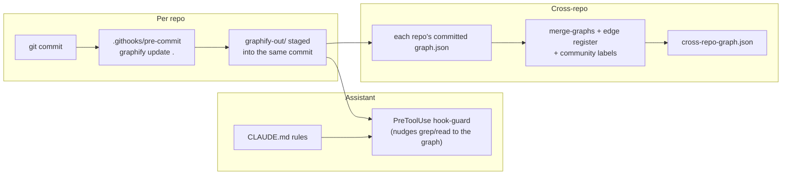

# 10. Keeping graphs current

An out-of-date graph is worse than no graph: an AI assistant trusts it, answers from code that no longer exists, and doesn't mention that the graph might be stale. This section shows a hook pattern that keeps each repo's graph current **in every commit**. It runs in production on [whitefieldwomania.com](https://whitefieldwomania.com) (an Astro + Cloudflare site). After that, it covers how to keep a **merged** multi-repo graph current on top of it.

There are three layers:



## Why not graphify's built-in hook?

graphify ships `graphify hook install`, which adds **post-commit / post-checkout** hooks. It works, but it has a timing problem:

| | Built-in post-commit (`graphify hook install`) | Versioned pre-commit (this pattern) |
|---|---|---|
| When it rebuilds | *After* the commit is made | *Before* the commit is finalised |
| Graph in commit N describes | The code at commit **N-1** | The code at commit **N** |
| PRs carry | A graph that lags one commit behind, or an extra "refresh graph" commit | Their own up-to-date graph |
| Where the hook lives | `.git/hooks/` (local, not shared) | `.githooks/` (versioned, reviewed like code) |
| Cost | AST-only, no LLM | AST-only, no LLM (~1.5 s on this repo) |

The whitefieldwomania.com history shows the switch. Before it, graph updates needed their own commit: `chore: refresh graphify knowledge graph (#334)`. Since the pre-commit hook landed (#336), there have been no refresh commits:

| Commit | Code files | `graph.json` changed? |
|---|---|---|
| `fix: serve new logo under a new filename ... (#338)` | 6 | Yes |
| `fix: serve logo as logo-v3.png ... (#340)` | 6 | No. Only a filename string changed, so the hook ran and updated AST cache entries, but the graph structure was identical. `PYTHONHASHSEED=0` means that shows up as no diff instead of noise |
| `fix: add 404 page ... (#342)` | 2 | Yes |

## The pre-commit hook

`.githooks/pre-commit`, committed to the repo:

```sh
#!/bin/sh
# Rebuild the graphify knowledge graph and include it in this commit, so every
# PR carries its own up-to-date graph. AST-only (no LLM), ~1.5s.
# Setup (once per clone): git config core.hooksPath .githooks
# Skip once: GRAPHIFY_SKIP_HOOK=1 git commit ...

[ "${GRAPHIFY_SKIP_HOOK:-0}" = "1" ] && exit 0

# Nothing to do when only graph files are staged
git diff --cached --name-only | grep -qv '^graphify-out/' || exit 0

G=$(command -v graphify || echo "$HOME/.local/bin/graphify")
if [ ! -x "$G" ]; then
  echo "pre-commit: graphify not installed, committing without graph refresh" >&2
  exit 0
fi

# ponytail: indexes the working tree, not just staged content; partial-staging commits
# can pick up graph changes from unstaged code. Fine for a single-dev repo.
if ! PYTHONHASHSEED=0 GRAPHIFY_SKIP_HOOK=1 "$G" update . >/dev/null 2>&1; then
  echo "pre-commit: graphify update failed, committing without graph refresh" >&2
  exit 0
fi
git add graphify-out
```

What each part is for:

| Line | Why it's there |
|---|---|
| `GRAPHIFY_SKIP_HOOK=1` check | A per-commit escape hatch, e.g. for an urgent hotfix |
| Skip if only `graphify-out/` is staged | Avoids pointless rebuilds and loops when you commit graph files on their own |
| `command -v graphify \|\| ...` and `exit 0` on failure | **Never blocks a commit.** A missing or broken graphify only means "no refresh this time" |
| `graphify update .` | Re-extracts **code only** with the AST (no LLM, no API key, no cost) |
| `PYTHONHASHSEED=0` | Deterministic output, so the same code gives the same `graph.json` and diffs stay small and reviewable |
| `GRAPHIFY_SKIP_HOOK=1` on the inner call | Stops a nested git operation from re-entering the hook |
| `git add graphify-out` | Puts the refreshed graph **into this commit** |

!!! warning "Known limitation"
    `graphify update` indexes the **working tree**, not just the staged files. If you stage part of your changes, the graph can include code you didn't commit. That's acceptable for a single-developer repo. On a team, run the hook against a clean checkout of the index (e.g. `git stash --keep-index`) or let CI rebuild the graph.

## One-time setup per clone

```bash
git config core.hooksPath .githooks          # use the versioned hooks
```

**A merge driver for `graph.json`.** Two branches that both changed code will both change `graph.json`, and a text merge of two big JSON files almost always conflicts. graphify ships a union merge driver:

```gitattributes
# .gitattributes (committed)
graphify-out/graph.json merge=graphify
```

```bash
# per clone (local git config; the path is your graphify install)
git config merge.graphify.name   "graphify graph.json union merge"
git config merge.graphify.driver "$(dirname "$(readlink -f "$(command -v graphify)")")/python -m graphify merge-driver %O %A %B"
```

**What to commit and what to ignore:**

```gitignore
# graphify: machine-specific files (file mtimes, daily local backups)
graphify-out/manifest.json
graphify-out/[0-9][0-9][0-9][0-9]-[0-9][0-9]-[0-9][0-9]/
graphify-out/cache/stat-index.json
```

| Commit | Ignore |
|---|---|
| `graph.json`, `GRAPH_REPORT.md`, `graph.html` | `manifest.json` (local file mtimes) |
| `cache/ast/` (per-file AST results, keyed by content hash, so other clones rebuild faster) | |
| `.githooks/`, `.gitattributes` | dated backup folders `graphify-out/YYYY-MM-DD/` |
| | `cache/stat-index.json` (rewritten on every run) |

## The assistant side: making the agent use the graph

A fresh graph only helps if the assistant reads it. Two pieces handle that in Claude Code.

**1. Rules in `CLAUDE.md`** (`graphify claude install` writes a starting version):

```markdown
## graphify
- For codebase questions, first run `graphify query "<question>"` when graphify-out/graph.json exists.
  Use `graphify path "<A>" "<B>"` for relationships and `graphify explain "<concept>"` for focused concepts.
- Read graphify-out/GRAPH_REPORT.md only for broad architecture review.
- The graph is rebuilt by the versioned pre-commit hook `.githooks/pre-commit` (AST-only) and staged
  into the same commit. Do not use graphify's post-commit/post-checkout hooks; they leave the graph trailing.
```

**2. `PreToolUse` guard hooks** in `.claude/settings.json`. graphify's `hook-guard` runs before the assistant greps or reads files, and nudges it toward the graph:

```json
{
  "hooks": {
    "PreToolUse": [
      { "matcher": "Bash|Grep",
        "hooks": [{ "type": "command", "command": "graphify hook-guard search", "timeout": 10 }] },
      { "matcher": "Read|Glob",
        "hooks": [{ "type": "command", "command": "graphify hook-guard read", "timeout": 10 }] }
    ]
  }
}
```

!!! tip "Use the full path in hooks"
    `graphify claude install` writes the absolute path to the `graphify` binary. Hooks run with a minimal `PATH`, so a bare `graphify` may not resolve. The absolute path is specific to your machine, though, so keep this file out of shared commits or document the path per developer.

## What the commit hook does *not* keep current

| Part of the graph | Kept current by the hook? | How to refresh |
|---|---|---|
| Code nodes and edges (AST) | **Yes**, every commit | Automatic |
| Doc / PDF / image concepts (semantic) | **No.** `update` is AST-only | `/graphify . --update` in the assistant. `graphify check-update .` reports when it's needed and is safe to run from cron |
| Community labels | No, ids can shift after re-clustering | Re-label (2-5 words each) after significant changes |
| Manual cross-repo edges | No | Edge register, below |
| Merged multi-repo graph | No | Merge job, below |

## Multi-repo: keeping the merged graph current

With the hook in each repo, **every repo's `main` always has a current `graph.json`.** The merged graph becomes a cheap, deterministic job that combines graphs you already have:

```bash
#!/bin/sh
# rebuild-merged.sh: run after any repo's main moves (cron, CI, or by hand)
set -e
graphify merge-graphs \
  ../drone-okg/graphify-out/graph.json \
  ../modal_io_serve/graphify-out/graph.json \
  --out cross-repo-graph.json

python3 apply_edges.py   cross-repo-graph.json cross_repo_edges.json   # fails loudly on stale ids
python3 regen_html.py    cross-repo-graph.json cross-repo-graph.html  # labels + readable HTML
```

`apply_edges.py` is the edge-register snippet from the [Playbook](playbook.md#merging), saved as a file. Its `assert` turns a renamed endpoint (e.g. `ServeL40S` → `ServeH100`) into a failing job instead of a missing edge that nobody notices. `regen_html.py` is in the [appendix](appendix.md).

Ways to trigger it, from simplest:

1. **By hand** when you're about to explore cross-repo questions.
2. **Scheduled CI** in a small "graphs" repo that checks out each repo at `main` and runs the script nightly.
3. **Repository dispatch**: each repo's CI sends an event on merge to `main`, and the graphs repo rebuilds.

!!! note "Alternative: the global graph (not used in this tutorial)"
    graphify also keeps a per-machine **global graph** (`~/.graphify/global-graph.json`): `graphify extract . --global --as <tag>`, `graphify global add <graph.json>`, `graphify global list` / `remove <tag>`. It's convenient on one workstation, but it isn't versioned or shared, so the manual-edge register and labels still need the script above.

## Checklist

- [ ] `.githooks/pre-commit` committed, and `git config core.hooksPath .githooks` run in each clone
- [ ] `.gitattributes` merge driver line committed, and the driver configured per clone
- [ ] `manifest.json`, dated backups and `cache/stat-index.json` in `.gitignore`
- [ ] `CLAUDE.md` rules plus `PreToolUse` guard hooks, so the assistant reads the graph
- [ ] Periodic `/graphify . --update` (or `check-update` from cron) for docs
- [ ] Merged graph rebuilt by a script that re-applies the edge register and labels
