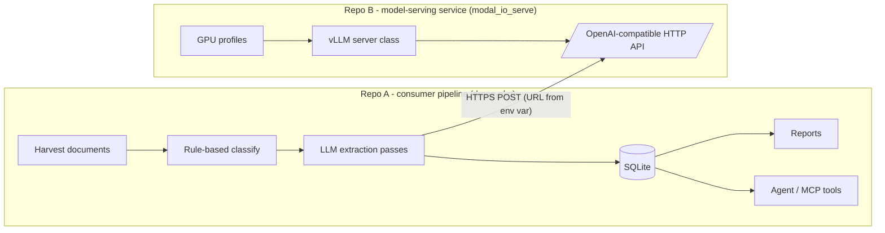

# 1. Problem statement

## The two repos, in canonical terms

Strip away the domain and you get a pattern almost every team that ships LLM features has:

| | **Repo A: consumer pipeline** | **Repo B: model-serving service** |
|---|---|---|
| Real name | `drone-okg` | `modal_io_serve` |
| Role | Scrapes public procurement bids, classifies them, mines specs with an LLM, stores results, renders reports, exposes an agent | Deploys open-weight LLMs on serverless GPUs behind an OpenAI-compatible endpoint |
| Size | 61 files (50 code, 11 docs), ~93k words | 7 files (6 code, 1 doc), ~2k words |
| Language | Python + Markdown | Python + Markdown |
| Talks to the other via | `requests.post(LLM_API_URL, ...)` | Exposes `POST /v1/chat/completions` |

## The canonical shape

- **Consumer**: a batch or online pipeline. It has many modules, a shared persistence layer, and a few *LLM touchpoints*, functions that send text to a model and get structured JSON back.
- **Provider**: a small infra repo. It holds hardware/runtime profiles, a server class per GPU type, and a thin API. It scales to zero, so the first request after an idle period hits a cold start.
- **Contract**: the OpenAI chat-completions request/response shape, plus three environment variables (`LLM_API_URL`, `LLM_MODEL`, `LLM_API_KEY`).

## Why this is hard for code-graph tools

A static code graph links things by **imports and calls**. Here the coupling is:

1. **A string**, the default value of `LLM_API_URL`, which encodes the deployment name and the GPU class.
2. **A protocol**: both sides agree on the OpenAI JSON shape, but neither imports a shared type.
3. **Operational assumptions**: the client's 20-minute timeout and its retry schedule exist *because* the server scales to zero. The two repos keep them in sync only through comments.

None of these is an import, so a merged graph shows two disconnected islands.

## The question that started it

> "How does modal_io_serve get called from drone-okg?"

The rest of this site builds the graphs, merges them, asks that question, finds the graph cannot answer it directly, and shows how we answered it anyway.
