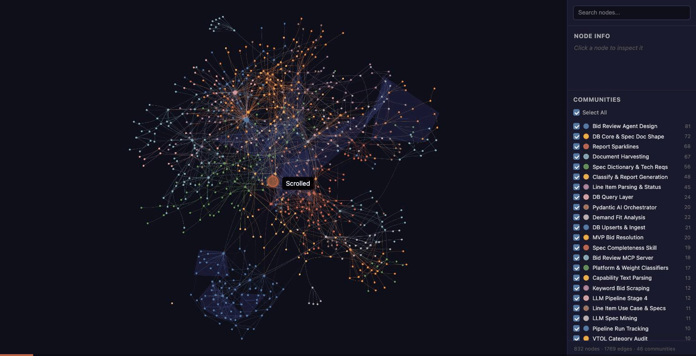

# 11. Visual walkthrough

A recorded tour of the interactive merged graph: communities first, then the two HTTP traces across the repo boundary.



[Open the interactive graph yourself](assets/cross-repo-graph.html){ .md-button .md-button--primary }

## What you are seeing

| Step | Action in the graph | What it shows |
|---|---|---|
| 1 | Full graph, 832 nodes, 46 colour-coded communities | Two repos and their structure. Shaded hulls are hyperedges (groups of 3+ related nodes) |
| 2 | Untick **Select All**, then tick six communities: *LLM Spec Mining*, *Capability Explanation Phrasing*, *Pydantic AI Orchestrator* (repo A), *Qwen3 vLLM Servers*, *GPU Serving Profiles*, *Modal Serving Concepts* (repo B) | Only the communities on either side of the HTTP boundary |
| 3 | Focus `call_local_llm()` | The shared batch LLM client. The info panel lists its 9 neighbours, including the three `extract_and_verify()` callers |
| 4 | Fit to `call_local_llm()`, `build_agent()`, `phrase_profile()`, `ServeL40S` | **The two manual `calls_http` edges** converge on `ServeL40S`. Its neighbour list starts with `call_local_llm()` and `build_agent()` |
| 5 | Click `call_local_llm()` in the neighbour list | Navigating the graph by following neighbour links |
| 6 | Search `build_agent`, open it | The live agent's model client: 4 neighbours, one of them `ServeL40S` in the other repo |
| 7 | **Select All** again, fit | Back to the full picture. The two edges you just followed are the only links between the repos |

## Try it yourself

- **Community filter:** untick *Select All*, then tick one or two communities to isolate a subsystem.
- **Search:** type part of a node name and click a result to focus it.
- **Neighbour links:** in *Node info*, click any neighbour to jump to it. This is the quickest way to trace a call chain by hand.
- **Zoom for labels:** labels appear as you zoom in. Every node has one, but graphify's default export hides labels on low-degree nodes (see [Communities](communities.md#a-visualization-gotcha)).

## How the recording was made

The graph HTML was served locally (`python3 -m http.server`) and driven in Chrome. Community toggles and camera moves went through the page's own functions: `toggleAllCommunities`, the legend checkboxes, and `network.focus` / `network.fit` from vis-network. Search and neighbour clicks were real UI clicks. The frames were exported as a GIF.

```js
// isolate the communities on each side of the HTTP boundary
document.getElementById('select-all-cb').click();
const keep = ['LLM Spec Mining', 'Pydantic AI Orchestrator', 'Qwen3 vLLM Servers' /* ... */];
document.querySelectorAll('.legend-item').forEach(li => {
  if (keep.includes(li.querySelector('.legend-label').textContent.trim()))
    li.querySelector('.legend-cb').click();
});

// frame the cross-repo trace
const ids = ['drone-okg::gem_insight_generator_mine_specs_llm_call_local_llm',
             'drone-okg::bid_review_agent_agent_orchestrator_build_agent',
             'modal_io_serve::src_qwen3_serve_servel40s'];
network.selectNodes(ids, true);
network.fit({ nodes: ids, animation: { duration: 1200 } });
```
